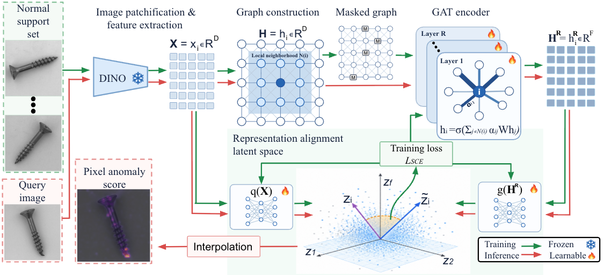

<div align="center">

# GATE-AD: Graph Attention Network Encoding for Few-Shot Industrial Visual Anomaly Detection

### NeurIPS 2026

[](https://arxiv.org/abs/2603.15300)
[](https://neurips.cc/virtual/2026/poster/151322)
[](https://www.python.org/)

**[Aggelos Psiris](mailto:aggelospsiris@hua.gr)** ·
**[Yannis Panagakis](mailto:yannisp@di.uoa.gr)** ·
**[Maria Vakalopoulou](mailto:maria.vakalopoulou@centralesupelec.fr)** ·
**[Georgios Th. Papadopoulos](mailto:g.th.papadopoulos@hua.gr)**

[[Paper](https://arxiv.org/abs/2603.15300)]
[[NeurIPS](https://neurips.cc/virtual/2026/poster/151322)]
[[Code](https://github.com/gthpapadopoulos/GATE-AD)]

</div>

> **GATE-AD has been accepted to NeurIPS 2026.** This repository contains the official implementation.

<p align="center">
  
</p>

## Overview

GATE-AD is a reconstruction-based framework for few-shot industrial visual anomaly detection. It models normality through local contextual relations: a patch is considered normal when its representation can be recovered consistently from its learned dependencies with neighboring patches.

The method:

- extracts dense patch-level features with a frozen DINOv2 or DINOv3 backbone;
- organizes the patch tokens as a spatial neighborhood graph;
- learns local dependencies with a masked Graph Attention Network encoder;
- aligns graph-conditioned predictions and frozen visual features in a shared latent space; and
- detects and localizes anomalies using Scaled Cosine Error reconstruction scores.

Across MVTec AD, VisA, and MPDD, GATE-AD achieves strong detection and localization performance in 1- to 8-shot settings while maintaining low inference latency. See the [paper](https://arxiv.org/abs/2603.15300) for complete results and ablations.

## Installation

Python 3.10 or newer is required.

```bash
git clone https://github.com/gthpapadopoulos/GATE-AD.git
cd GATE-AD

conda create -n gate-ad python=3.10 -y
conda activate gate-ad
python -m pip install --upgrade pip
pip install -r requirements.txt
```

## Datasets

Download the datasets from their official sources:

- [MVTec AD](https://www.mvtec.com/company/research/datasets/mvtec-ad)
- [VisA](https://github.com/amazon-science/spot-diff)
- [MPDD](https://github.com/stepanje/MPDD)

Place them under `datasets/`:

```text
datasets/
├── mvtec/
├── visa/
│   └── split_csv/1cls.csv
└── mpdd/
```

MVTec AD and MPDD must follow the MVTec-style layout:

```text
<data_root>/<object_name>/
├── train/good/*.png
├── test/good/*.png
├── test/<defect_type>/*.png
└── ground_truth/<defect_type>/*_mask.png
```

VisA is loaded from `split_csv/1cls.csv`. The CSV must contain the fields `object`, `split`, `label`, `image`, and `mask`. Image and mask paths may be absolute or relative to `datasets/visa`.

## Backbone Weights

Download the official pretrained weights from:

- [DINOv2](https://github.com/facebookresearch/dinov2)
- [DINOv3](https://github.com/facebookresearch/dinov3)

Place checkpoints in `weights/`, then pass the path through `--backbone_ckpt` or set `backbone_ckpt` in the dataset configuration file.

## Running GATE-AD

Default configurations are provided in `configs/defaults/` for MVTec AD, VisA, and MPDD.

Run one benchmark:

```bash
bash scripts/run_mvtec_default.sh
bash scripts/run_visa_default.sh
bash scripts/run_mpdd_default.sh
```

Run all benchmarks:

```bash
bash scripts/run_all_defaults.sh
```

### Run a Single Category

MVTec AD example:

```bash
PYTHONPATH=src python -m gate_ad.cli.run_one \
  --dataset mvtec \
  --object_name screw \
  --data_root ./datasets/mvtec \
  --model_name dinov2_vitl14_reg \
  --backbone_ckpt ./weights/dinov2_vitl14_reg4_pretrain.pth \
  --device cuda:0 \
  --resolution 488 \
  --backbone_last_n_layers 8 \
  --backbone_layer_agg avg \
  --shots 1 \
  --seed 0 \
  --epochs 2000 \
  --lr 3e-4 \
  --mask_ratio 0.2 \
  --a 2.0 \
  --gnn_layers 3 \
  --latent_dim 256 \
  --gnn_hidden_dims 256,256,256 \
  --dropout 0.3 \
  --topk_ratio 0.025 \
  --image_score_pool topk_mean \
  --out_dir ./outputs_manual \
  --run_name mvtec_screw_example
```

VisA example:

```bash
PYTHONPATH=src python -m gate_ad.cli.run_one \
  --dataset visa \
  --object_name chewinggum \
  --data_root ./datasets/visa \
  --visa_split_csv ./datasets/visa/split_csv/1cls.csv \
  --model_name dinov3_vitb16 \
  --backbone_ckpt ./weights/dinov3_vitb16_pretrain_lvd1689m-73cec8be.pth \
  --device cuda:0 \
  --resolution 512 \
  --backbone_last_n_layers 8 \
  --backbone_layer_agg avg \
  --shots 1 \
  --seed 0 \
  --epochs 2000 \
  --lr 3e-4 \
  --mask_ratio 0.2 \
  --a 2.0 \
  --gnn_layers 3 \
  --latent_dim 256 \
  --gnn_hidden_dims 256,256,256 \
  --dropout 0.3 \
  --topk_ratio 0.01 \
  --image_score_pool topk_mean \
  --out_dir ./outputs_manual \
  --run_name visa_chewinggum_example
```

## Citation

If GATE-AD is useful in your research, please cite:

```bibtex
@inproceedings{psiris2026gatead,
  title     = {{GATE-AD}: Graph Attention Network Encoding for Few-Shot Industrial Visual Anomaly Detection},
  author    = {Psiris, Aggelos and Panagakis, Yannis and Vakalopoulou, Maria and Papadopoulos, Georgios Th.},
  booktitle = {Advances in Neural Information Processing Systems},
  year      = {2026}
}
```

## Acknowledgements

GATE-AD builds on pretrained representations from [DINOv2](https://github.com/facebookresearch/dinov2) and [DINOv3](https://github.com/facebookresearch/dinov3). We thank the authors and maintainers of these projects and the MVTec AD, VisA, and MPDD benchmarks.
